

<a href="https://www.linkedin.com/in/mohamed0badry/"></a><a href="https://discord.com/users/573548974636793876"></a><a href="https://dev.to/mohamedbadry"></a><a href="mailto:m.badry.fl@gmail.com"></a>
<a href="https://github.com/Mohamed-Badry/statui"></a><a href="https://github.com/Mohamed-Badry/islp-solutions"></a>
<a href="https://github.com/Mohamed-Badry/nixos-dotfiles"></a><a href="https://github.com/Mohamed-Badry/wedjat"></a>
<a href="https://github.com/georgekobaidze"></a>

